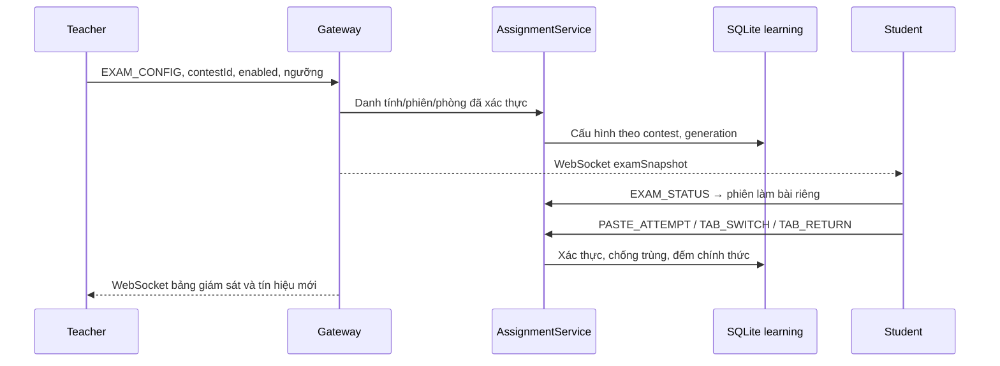

# Exam Mode — hạn chế dán code và giám sát tín hiệu rời trang

Ngày cập nhật: 05/11/2026. Đây là tính năng hỗ trợ giáo viên xem xét tín hiệu trong kỳ thi, không xác định AI hay tự kết luận gian lận.

## 1. Phân tích và lựa chọn kiến trúc

| Thành phần hiện có | Cách tích hợp |
|---|---|
| Java server, không Spring/backend Node | Bổ sung nhánh `EXAM_*` trong AssignmentService |
| Frontend HTML/CSS/JavaScript ES Modules | Thêm module exam-monitoring.js và CSS, không cài thư viện |
| Editor bài thi là textarea `#contest-code` | Bắt sự kiện capture trên document; không dùng Monaco |
| TEACHER/STUDENT, Teacher chỉ quản lý lớp của mình | Tái sử dụng gateway.identity(), isMember(), isTeacher() và kiểm tra contest.roomId |
| HTTP/HTTPS 8080 → WebGatewayServer → AssignmentService | Tái sử dụng `/api/assignments`; không tạo hệ thống auth mới |
| WebSocket `/presence` ở 8081 mặc định | Bổ sung examSnapshot trong thông điệp hiện có; polling dự phòng |
| MySQL tùy chọn cho tài khoản/lớp/phiên/điểm danh | Không thay schema hay nguồn xác thực MySQL |
| SQLite lõi cho code/chat; SQLite learning cho kỳ thi và chấm | Lưu giám sát trong chính database learning cùng kỳ thi |
| TCP 5000/5001/5002 và Docker chấm code | Giữ nguyên giao thức, queue/worker và tính điểm |

Workspace không có Git repository để lấy diff. Trước thay đổi đã lưu source/test vào `server/build/exam-mode-baseline-20261105-014924.zip`. Không sao chép mật khẩu hoặc database vận hành vào bản source baseline; không sửa `.env`, cài dependency hay khởi động lại server đang dùng.

## 2. Luồng hoạt động



Exam Mode mặc định tắt. Giáo viên chủ phòng có thể bật/tắt cho từng kỳ thi và đặt ngưỡng từ 1–100. Cấu hình do server lưu; chỉ có hiệu lực giám sát trong khoảng bắt đầu/kết thúc của kỳ thi theo đồng hồ server. Không tự động trừ điểm, hủy bài hay đổi kết quả AC/WA.

Student được copy, gõ code, Undo/Redo bình thường. Khi đang làm bài trong Exam Mode, chặn mọi thao tác dán vào editor bài thi vì không thể phân biệt đáng tin cậy clipboard nội bộ và bên ngoài. Chặn Ctrl/Meta+V, Shift+Insert, sự kiện paste của menu chuột phải, beforeinput insertFromPaste và thả nội dung vào editor. Với beforeinput không thể hủy, phục hồi giá trị editor trước thao tác trên input; không đọc clipboard.

Các sự kiện của cùng lần dán được gom trong khoảng 600 ms ở client. TAB_SWITCH và TAB_RETURN tạo một chu kỳ rời/quay lại; blur và visibilitychange không đếm hai lần cho cùng chu kỳ. Blur được ghi là tín hiệu mất focus bổ sung, không phải bằng chứng đã chuyển sang một ứng dụng cụ thể. Việc chuyển sang mục khác bên trong StudyFix trong lúc phiên thi đang hoạt động cũng được ghi với source=navigation qua polling.

Nhãn nhỏ trên editor hiển thị trạng thái và cảnh báo; không mở popup chặn nhập liên tục. Tính năng không chặn paste ở luyện code, chat hay khi Exam Mode tắt. Khi rời lớp/đăng xuất, không tiếp tục gán tín hiệu của phòng cũ vào phòng mới.

## 3. Server, dữ liệu và quyền

Migration tự chạy khi mở AssignmentRepository/ExamMonitoringRepository, chỉ tạo bảng/index còn thiếu:

- `p3_exam_modes`: cấu hình, generation, tab_limit, paste_limit, updated_at theo contest_id.
- `p3_exam_sessions`: phiên làm bài, user_id lấy từ Identity, hash SHA-256 của phiên core, tên chụp lúc bắt đầu, thời gian, trạng thái away, bộ đếm và thời lượng.
- `p3_exam_events`: event_id để chống trùng, loại/nguồn, thời gian client báo, thời gian server nhận và khoảng vắng theo thời điểm server nhận.
- `p3_exam_migrations`: version 1 của module giám sát. Không sửa/xóa bài thi, bài nộp, testcase, điểm hay dữ liệu cũ.

Một login/contest/generation có một examSessionId. ExamSessionId công khai không phải token xác thực. Khi gửi sự kiện, server còn đối chiếu user_id và hash phiên core thật; không tin studentId/sessionId/roomId/count do client tự khai. WebGateway ghi đè core session và room từ phiên đã đăng nhập. Các trường ngoài whitelist không được lưu; clipboard/sourceCode không có trong schema sự kiện.

API dùng `/api/assignments`, body có `type`:

| Type | Quyền và tác dụng |
|---|---|
| EXAM_CONFIG | Chủ phòng: bật/tắt, lưu ngưỡng cho kỳ thi thuộc phòng |
| EXAM_STATUS | Thành viên: cấu hình server; Student nhận phiên/count của chính kết nối đó |
| EXAM_EVENT | Student: gửi eventId, contestId, examSessionId, eventType, source, clientAt |
| EXAM_MONITOR | Chủ phòng: bảng tổng hợp và tín hiệu gần đây |
| EXAM_HISTORY | Chủ phòng: lọc studentId/eventType, phân trang 100 sự kiện bằng before |
| EXAM_SNAPSHOT | Thành viên: danh sách mode trong phòng; chỉ chủ phòng nhận monitors |

Server tự tăng bộ đếm, khóa ghi theo repository và lưu giao dịch SQLite; unique(exam_session_id,event_id) chống retry trùng. TAB_SWITCH khi đang away hoặc TAB_RETURN khi đã quay lại không tăng lần nữa. Tối đa 30 sự kiện được lưu/10 giây/phiên; client giữ sự kiện và thử đồng bộ lại khi bị giới hạn. Giá trị ngưỡng được kiểm tra phạm vi ở server.

Bật lại sau khi tắt tạo generation mới: bảng chính hiển thị bộ đếm của lượt bật hiện tại, lịch sử các lượt trước vẫn tra được. Restart giữ cấu hình và lịch sử, nhưng login mới có phiên làm bài mới; không dùng phiên cũ để gửi cho một tài khoản/kết nối khác. Nhiều thiết bị cùng tài khoản có exam session riêng và được tổng hợp theo sinh viên. Trạng thái hoạt động dựa trên status/heartbeat ứng dụng gần nhất trong 30 giây; đây không phải phép đo người dùng đang nhìn màn hình.

## 4. Realtime và mất mạng

WebSocket sẵn có gửi examSnapshot khoảng mỗi 2 giây khi dữ liệu thay đổi. Student chỉ nhận mode, không nhận dữ liệu giám sát của người khác. Polling hiện có gọi EXAM_STATUS/EXAM_MONITOR khoảng 5 giây/lần để dự phòng; không tạo socket/backend mới.

Khi mạng gián đoạn trong trang đang mở, vẫn dùng chính sách Exam Mode đã xác nhận gần nhất để chặn dán. Sự kiện metadata có eventId ổn định được giữ trong sessionStorage, tối đa 100 mục/tài khoản/tab, rồi thử gửi lại. Không lưu clipboard trong hàng đợi. Server vẫn xác thực lại từng sự kiện khi nhận; event cũ không được gán vào generation hoặc login mới. Phản hồi cũ không được bật ngược Exam Mode sau khi đã nhận lệnh tắt mới.

Hạn chế: offline lâu vượt TTL đăng nhập phải đăng nhập/xin vào lớp lại. Tín hiệu của login cũ có thể không được chấp nhận sau khi phiên hết hạn; không giả lập số liệu để bù. Hàng đợi đầy hoặc trình duyệt bị đóng trước khi đồng bộ có thể mất tín hiệu. Khoảng vắng tính theo lúc server nhận, không được coi là thời lượng thực tuyệt đối khi gửi bù sau offline. Thời gian client báo được lưu riêng và không được tin làm bộ đếm/đồng hồ thi chính thức.

## 5. Cách chạy và sử dụng

1. Đóng Server Manager cũ; sao lưu thư mục `server/data` khi server đã dừng. Không cần cài thư viện hay chạy SQL thủ công.
2. Từ thư mục `StudyFix_Seven_Bugfixes`, chạy:

```powershell
powershell -NoProfile -ExecutionPolicy Bypass -File .\StudyFix\server\run-server-manager.ps1
```

3. Hai máy Ctrl+Shift+R. Dùng URL HTTP/HTTPS đang cấu hình; mic/camera vẫn cần HTTPS qua LAN theo hướng dẫn riêng.
4. Teacher vào lớp do mình quản lý. Từ cuộc họp có thể bấm logo StudyFix để về màn hình chính mà vẫn giữ lớp, sau đó mở **Thi & xếp hạng**.
5. Tạo/chọn kỳ thi → **Xem kỳ thi** → khung **GIÁM SÁT BÀI KIỂM TRA** → **Bật Exam Mode**. Nhập ngưỡng và bấm **Lưu ngưỡng** khi cần.
6. Student được duyệt vào cùng lớp → mở **Thi & xếp hạng** → **Vào thi** → **Làm bài**. Nếu đang trong giờ thi và mode bật, nhãn giới hạn xuất hiện trên editor.
7. Teacher xem bảng tự cập nhật, lọc sinh viên/tín hiệu, bấm **Lịch sử tín hiệu** hoặc **Xem tất cả sự kiện**. Học sinh không có nút/API quản trị.
8. Bấm **Tắt Exam Mode** để trả về thao tác dán bình thường trong kỳ thi. Không đổi điểm hay bài nộp đã có.

## 6. Kiểm thử hai máy LAN

| Thử nghiệm | Kết quả mong đợi |
|---|---|
| Chưa bật mode, Student dán vào bài thi/luyện tập | Dán bình thường, không có event giám sát |
| Bật mode, Ctrl+V/Shift+Insert/menu Paste vào editor bài thi | Code không được dán; banner và một tín hiệu paste |
| Gõ code, Ctrl+Z/Ctrl+Y | Vẫn hoạt động |
| Chuyển tab/minimize rồi quay lại | Một chu kỳ rời/quay lại; Teacher thấy count và lịch sử |
| Blur và visibilitychange từ cùng thao tác | Không tăng hai lần |
| Teacher đổi ngưỡng | Đánh dấu Cần kiểm tra theo count chính thức, không tự trừ điểm |
| Student gọi EXAM_CONFIG/MONITOR/HISTORY | Bị từ chối |
| Teacher B xem/sửa exam phòng A | Bị từ chối |
| Refresh và mở lại kỳ thi | Nhận mode từ server trước khi mở editor |
| Ngắt mạng ngắn rồi kết nối lại | Vẫn chặn dán trong mode đã biết; gửi bù metadata khi phiên còn hợp lệ |
| Hai thiết bị cùng tài khoản | Exam session riêng, không dùng id của thiết bị khác để gửi sự kiện |
| Tắt mode/hết giờ | Không tiếp tục chặn dán/thu nhận event mới |

Thử thực tế menu chuột phải, bàn phím Windows/bộ gõ và các trình duyệt sử dụng tại lớp. Mất focus do hộp thoại hệ thống, quyền thiết bị hoặc công cụ trợ năng cũng có thể tạo tín hiệu; giảng viên cần xem nguồn và bối cảnh.

## 7. File thay đổi

- `server/src/studyfix/assignment/persistence/ExamMonitoringRepository.java` (mới): migration, config/session/event, chống trùng/rate limit, bảng và lịch sử.
- `.../AssignmentRepository.java`: chia sẻ hàm mở kết nối trong package, giữ PRAGMA hiện có.
- `.../service/AssignmentService.java`: tái sử dụng xác thực, quyền chủ phòng và kiểm tra contest để xử lý EXAM_*.
- `server/src/studyfix/WebGatewayServer.java`: whitelist API và đưa snapshot vào WebSocket hiện có.
- `web-client/static/features/contests/exam-monitoring.js` (mới): guard dán, theo dõi visibility/focus/navigation, offline queue và UI giám sát.
- `.../contests.js`: tải mode trước khi mở bài, render banner/bảng.
- `core/events.js`, `core/polling.js`, `core/presence-socket.js`, `core/api.js`: nối sự kiện, fallback polling, snapshot và mã lỗi.
- `exam.css` (mới), `index.html`: giao diện responsive cùng phong cách hiện có.
- `server/test/studyfix/ExamModeIntegrationTest.java` (mới), `MySqlAdminIntegrationTest.java`: quyền, chính sách, counters, dữ liệu và WebSocket với server thật.
- `web-client/tests/check_exam_monitoring.mjs`, `exam_mode_browser.cjs` (mới): DOM/HTTP giả lập và Chrome với backend thật.
- `server/build.xml`: target exam-mode-test, tích hợp vào integration-test.

## 8. Kiểm chứng và giới hạn

Kết quả cuối và đường dẫn log được ghi ở phần cuối tài liệu. Test mô phỏng không được coi là bằng chứng của mọi thao tác OS/trình duyệt. Không kiểm thử media vật lý hoặc LAN hai máy trong đợt này; không chạy Docker chấm thật cho tính năng giám sát vì không đổi bộ chấm.

Giới hạn quan trọng:

- JavaScript có thể bị tắt/sửa, sự kiện có thể bị bỏ hoặc giả trong trình duyệt của chính sinh viên; server xác thực người gửi và đếm, không chứng minh một event là hành vi gian lận thật.
- Không xác định được tên ứng dụng, website khác, AI/ChatGPT, người đứng ngoài máy hay thiết bị thứ hai.
- Không phân biệt đáng tin cậy clipboard nội bộ/bên ngoài; chặn paste vào editor bài thi ở cả hai trường hợp. Copy được giữ để không phá thao tác soạn thảo.
- Không quay màn hình, đọc clipboard, keylog hoặc thu nội dung ứng dụng khác. Tín hiệu không thay thế việc coi thi.
- Native menu chuột phải và hệ điều hành/bộ gõ cụ thể vẫn cần kiểm thử tại lớp; test tự động đã kiểm tra đường paste event và phím tắt.

Nguồn API trình duyệt: [visibilitychange](https://developer.mozilla.org/en-US/docs/Web/API/Document/visibilitychange_event), [beforeinput và giới hạn hủy sự kiện](https://developer.mozilla.org/en-US/docs/Web/API/Element/beforeinput_event).

### Kết quả đã chạy trên source cuối

| Hạng mục | Kết quả | Bằng chứng |
|---|---|---|
| Java/Ant integration-test | BUILD SUCCESSFUL, 2 phút 30 giây | `server/build/exam-ant-verified.log` |
| Exam API, SQLite thật và WebSocket | 31 kiểm tra, gồm identity/owner guard, phiên riêng, chống trùng, threshold, spam, disable/re-enable, navigation và restart | Cùng log Ant, target exam-mode-test |
| Chrome + backend thật | Luồng clipboard/phím tắt, paste event, Undo, Teacher realtime/history, rời/quay lại, offline/reconnect và refresh đạt; 32 kiểm tra khi chạy cùng bài tích hợp | `server/build/exam-browser-verified.log`; ảnh `server/build/exam-browser-qa/` |
| MySQL thật, instance/schema tách biệt | 108 kiểm tra đạt, có kiểm tra danh tính MySQL gửi Exam event vào SQLite learning và Student không đọc được monitor | `server/build/exam-mysql-verified.log` |
| Frontend | 16 script đạt, gồm check_exam_monitoring và 15 hồi quy cũ | `server/build/exam-frontend-verified.log` |

Kiểm tra Windows service sau test: MySQL80 vẫn Running. Không cài thư viện mới, sửa `.env`, mở firewall hoặc dùng database vận hành để test. Kết quả Chrome dùng localhost; chuỗi visibility/blur được điều khiển để kiểm tra ổn định, không phải chứng minh mọi thao tác chuyển ứng dụng Windows. Paste qua phím tắt dùng clipboard trình duyệt thật; đường paste event được kiểm tra riêng, native menu OS cần thử tiếp bằng tay.
