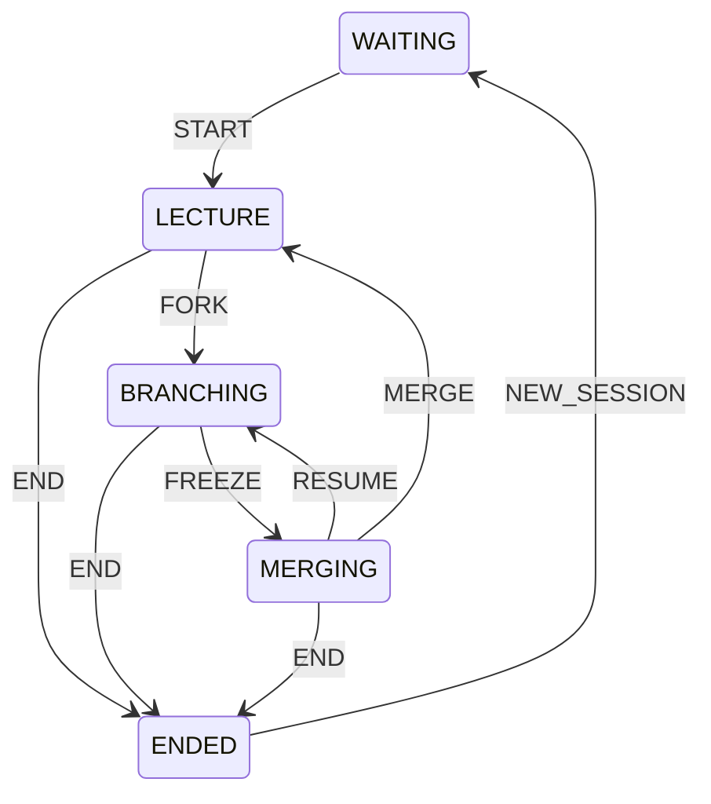

# Kiểm tra kiến thức bộ slide và các sơ đồ StudyFix

Ngày đối chiếu: 04/11/2026. Nguồn: `C:/Users/ADMIN/Downloads/StudyFix_Project_Overview_28_slides.pptx`, bốn ảnh người dùng gửi và source hiện tại. Đã đọc nội dung 28 slide và cấu trúc các shape/connector liên quan trong PPTX. Chưa mở trình chiếu trong PowerPoint; đây là đánh giá nội dung kỹ thuật, không phải nghiệm thu layout bằng PowerPoint. Chưa sửa file PPTX hay source.

## Kết luận

Nội dung mô tả sản phẩm, vai trò, Master/nhánh, sandbox, hai database và WebRTC nhìn chung bám source. Tuy nhiên cần sửa sơ đồ trạng thái và kiến trúc, làm rõ framing nhị phân, cập nhật slide kiểm thử và phân biệt các loại storage. Các ảnh gửi kèm không hoàn toàn trùng với sơ đồ trong PPTX, nên được đánh giá riêng bên dưới.

## 1. Bốn ảnh gửi kèm

### Ảnh 1 — State machine phiên học: sai đường quay lại

Nhãn `RESUME/MERGE -> LECTURE` gộp hai hành động có đích khác nhau; đường vẽ lại quay về BRANCHING nên càng dễ hiểu nhầm.

Theo [ClassroomService.java](../server/src/studyfix/ClassroomService.java), state machine cần có các chuyển trạng thái sau:

| Trạng thái trước | Hành động | Trạng thái sau |
|---|---|---|
| WAITING | START | LECTURE |
| LECTURE | FORK | BRANCHING |
| BRANCHING | FREEZE | MERGING |
| MERGING | RESUME | BRANCHING |
| MERGING | MERGE | LECTURE |
| LECTURE | END | ENDED |
| BRANCHING | END | ENDED |
| MERGING | END | ENDED |
| ENDED | NEW_SESSION | WAITING |



Chuyển trạng thái còn cần thỏa quyền chủ phòng, expectedPhase/round và các guard của hành động. END không được chấp nhận ở WAITING hoặc ENDED. FREEZE tạm khóa việc lưu nhánh, không tự thu hồi mọi nháp chưa gửi trên máy học sinh. MERGE chọn toàn bộ source một nhánh thành Master, không phải Git merge nhiều nhánh và không có điều kiện bắt buộc AC trong case MERGE hiện tại.

### Ảnh 2 — Đăng nhập: luồng chính đúng, cần viết rõ các định danh

Browser POST `/api/auth/login` → gateway mở TCP nội bộ → `/login` → xác thực bằng PBKDF2 → tạo WebSession/token → browser gửi bearer ở request sau: đúng theo [WebGatewayServer.java](../server/src/studyfix/WebGatewayServer.java), [ClientHandler.java](../server/src/studyfix/ClientHandler.java), [Store.java](../server/src/studyfix/Store.java).

Ô phản hồi nên ghi đúng cấu trúc:

```text
[LOGIN_OK] session=<sessionId> userId=<userId> role=<TEACHER|STUDENT> | <displayName>
```

Không viết theo cách khiến người nghe hiểu `sessionId = userId`. sessionId là kết nối lõi; userId là tài khoản; bearer token là mã phiên web; peerId là định danh thiết bị signaling. Role được đọc từ dữ liệu tài khoản, không lấy theo role browser tự khai.

Trong bản source hiện tại, `Store.login()` chỉ giữ khóa khi đọc dữ liệu tài khoản; PBKDF2 thực hiện bên ngoài khóa Store. Không nên trình bày PBKDF2 chạy trong toàn bộ transaction lớp học.

### Ảnh 3 — Frame mạng: phần trên đúng, phần dưới thiếu định nghĩa độ dài

Theo [Protocol.java](../server/src/studyfix/Protocol.java) và [AssignmentWire.java](../server/src/studyfix/assignment/protocol/AssignmentWire.java):

```text
TCP 5000 / 5002:
[4 byte signed int, big-endian: N][N byte UTF-8]
0 <= N <= 65.536 byte; 5000 là payload lệnh văn bản, 5002 là JSON.
```

Đây là độ dài byte, không phải số ký tự. Giới hạn frame hợp lệ không có nghĩa mọi payload rỗng đều hợp lệ về nghiệp vụ. Giao thức này là của các socket TCP ứng dụng, không mô tả trực tiếp body HTTP của trình duyệt.

Theo [ScreenShareWire.java](../server/src/studyfix/screenshare/ScreenShareWire.java), header nhị phân 5001 **tính cả byte loại**:

```text
[4 byte: L = 1 + N][1 byte loại][N byte payload]
1 <= L <= 2 * 1024 * 1024
N tối đa = 2 * 1024 * 1024 - 1
```

HELLO=1, FRAME=2, STOP=3, ERROR=4, STATUS=5: đúng. Nếu ghi header là N trong khi N là riêng payload, bên nhận sẽ đọc thiếu một byte và lệch frame. Đây là relay native; mic/camera/màn hình browser đi bằng WebRTC.

### Ảnh 4 — Kiến trúc nhiều client: sai liên kết và đã cũ về phạm vi client

- Thư mục client Swing đã xóa; nếu mô tả phiên bản hiện tại tập trung web thì bỏ khối Swing client hoặc ghi rõ là kiến trúc lịch sử.
- Console client dùng TCP 5000 tới Server/ClientHandler; không nối console client tới ScreenShareRelay 5001 như mũi tên trong ảnh.
- Server Manager khởi động/quản lý core, assignment và gateway; nối riêng Manager tới AssignmentTcpServer dễ khiến người nghe hiểu nó chỉ điều khiển một dịch vụ. Nên đặt Manager là khối vận hành bao quanh hoặc điều khiển các dịch vụ qua hàm Java cùng JVM.
- Cần vẽ gateway → server lõi bằng TCP nội bộ 5000, gateway → ClassroomService bằng lời gọi Java, gateway → AssignmentTcpServer.handleWebRequest() → AssignmentService bằng lời gọi Java.
- Queue gửi 64 thuộc **mỗi ClientHandler**, không phải một queue broadcast 64 dùng chung cho Room.
- Trình bày riêng queue AssignmentService và grader ClassroomService. Cùng dùng sandbox không đồng nghĩa cùng một queue.
- Giữ WebRTC media giữa browser peers; gateway làm signaling, không phải SFU/relay media của browser.

Các đích liên kết đối chiếu ở [ServerAdmin.java](../server/src/studyfix/ServerAdmin.java), [Server.java](../server/src/studyfix/Server.java), [Client.java](../server/src/studyfix/Client.java), `WebGatewayServer`, `ClientHandler` và [AssignmentTcpServer.java](../server/src/studyfix/assignment/transport/AssignmentTcpServer.java).

## 2. Đánh giá đủ 28 slide

| Slide | Đánh giá nội dung | Điều cần chỉnh hoặc lưu ý |
|---|---|---|
| 1 | Đúng về giới thiệu | Chừa thông tin nhóm để tự điền là phù hợp; không phải bằng chứng tính năng |
| 2 | Hợp lý về bài toán/mục tiêu | Hai ô đang chứa nguyên chuỗi dạng Python list `['...', '...']`; nên chuyển thành các đoạn/bullet bình thường. Đây là lỗi trình bày, không phải logic hệ thống |
| 3 | Đúng tổng quan | Check là chức năng hỗ trợ, không phải điều kiện bắt buộc backend mới cho Merge |
| 4 | Đúng ở mức mục tiêu chức năng | “Giá trị” là ý nghĩa thiết kế, không phải số liệu chứng minh hiệu quả học tập |
| 5 | Đúng chính | Giáo viên điều khiển phiên phải là chủ phòng; Practice cũng dùng được cho giáo viên |
| 6 | Đúng | Các nhóm chức năng vẫn được phân biệt trong source |
| 7 | Đúng tổng quan, thiếu chi tiết đường backend | Nên bổ sung TCP nội bộ 5000. Web gọi nghiệp vụ assignment trực tiếp trong JVM, không gửi TCP 5002 từ browser |
| 8 | Đúng | HTTPS phụ thuộc cấu hình; Docker JDK 21 là image chấm, không phải JDK chạy server |
| 9 | Đúng | Đếm hiện tại có 24 module JS trong static; không nhầm số JS với tổng số file HTML/CSS/Java |
| 10 | Đúng ở mức phân lớp | Nên thể hiện thêm Server/ClientHandler/Room/Store nếu dùng slide này để giải thích server lõi |
| 11 | Đúng luồng chính | Token browser ở sessionStorage, password dùng PBKDF2; token web không tự được coi là JWT |
| 12 | Đúng vòng đời phòng, cần làm rõ persistence | Phòng trống được giữ, soft-delete đúng. Membership kết nối đang chạy không được tự khôi phục như các kết nối còn sống sau restart |
| 13 | Đúng cơ chế Master/nhánh | Đổi “Đóng vòng chỉnh sửa” thành “Tạm khóa sửa nhánh” vì RESUME cho sửa tiếp cùng vòng |
| 14 | Cần sửa sơ đồ | Connector có nhãn RESUME/MERGE đang hướng từ khu vực MERGING lên ENDED. Cần tách RESUME về BRANCHING và MERGE về LECTURE; bổ sung NEW_SESSION và các đường END hợp lệ |
| 15 | Đúng | Autosave khoảng 1,2 giây là debounce khi dừng gõ, còn phụ thuộc mạng/phase; không cam kết cứ 1,2 giây có một bản ghi |
| 16 | Đúng nguyên tắc | expectedPhase/round của hành động chủ phòng; lưu nhánh có phase/round/version riêng. Transaction commit → publish RAM áp dụng theo luồng ghi liên quan, không có distributed transaction bao trùm hai DB/media |
| 17 | Đúng chính | Recipient snapshot phục vụ giao bài/tiến độ; khác membership đang online. DEBUG_COLLAB có điều kiện riêng về scope |
| 18 | Đúng | Practice không cần phòng; Contest hiện là INDIVIDUAL/BUILD_FROM_SCRATCH, TEAM_COLLAB bị từ chối |
| 19 | Đúng chính | RUN luyện tập chỉ public tests; nộp chính thức dùng bộ test phù hợp. DONE không đồng nghĩa AC, còn có lỗi dịch vụ |
| 20 | Đúng sandbox chính | Compile cần mount work ghi được; code test được mount read-only. Container compile và lượt test tách biệt; không nói một container chứa toàn bộ server |
| 21 | Đúng | Cursor chưa đọc frontend khác server read receipt cho từng người/thiết bị |
| 22 | Đúng với điều kiện | 1.600 ms là interval đặt lịch; request có thể chậm và pollingBusy bỏ lượt nên không hứa cập nhật đúng mỗi 1,6 giây |
| 23 | Đúng | Có hai DB; nhánh/revision/phase core có thể lưu nhất quán trong core transaction |
| 24 | Đúng về chạy chính | Browser gọi 8080; 5000/5002 là các listener backend. Core còn mở relay 5001 mặc dù browser không dùng relay đó |
| 25 | Cần cập nhật bằng chứng | “Ant/Docker chưa chạy lại” đã cũ. Số 71 Java files không khớp kiểm kê hiện tại; “9 scripts/192 checks PASS” cần log và ngày cụ thể, không dùng như kết quả hiện tại chưa đối chiếu |
| 26 | Cần sửa storage của draft | Draft lớp học dùng sessionStorage, Practice dùng localStorage cùng Map RAM. Không nói mọi draft chỉ nằm trong sessionStorage |
| 27 | Đúng một số ưu tiên, cần cập nhật trạng thái | Lỗi refreshMe trong polling.js vẫn thấy trong source. Docker AC/WA/CE và backend integration đã có log chạy mới; không tiếp tục ghi như chưa từng xác minh. Nghiệm thu media LAN/HTTPS vẫn cần riêng |
| 28 | Phù hợp phần kết luận | Nên dùng như mục tiêu/điểm nhấn sản phẩm; không biến thành kết luận thực nghiệm hiệu quả học tập chưa đo |

## 3. Nội dung kiểm thử nên thay ở slide 25

Kiểm kê source tại thời điểm đọc: **43 file Java production trong server/src, 21 file Java test trong server/test, 24 module JavaScript frontend**. Nói 71 Java files mà không chỉ rõ phạm vi/ngày đo là không khớp source hiện tại. Tổng của hai nhóm Java trên là 64, không phải 71.

Bằng chứng mới có trong workspace:

- [server-reliability-full-regression.log](../server/build/server-reliability-full-regression.log): `BUILD SUCCESSFUL`; có Classroom 112, Meeting signaling 34, Chat 16, RoomLifecycle 72, Practice 63, ServerMonitor 39 và ServerReliability 19 checks; còn có các suite lịch sử/recovery/console khác. Không dùng các số này như kết quả đo hiệu năng.
- [server-reliability-docker.log](../server/build/server-reliability-docker.log): 25 checks PASS, HTTP + Docker thật với AC/WA/lỗi biên dịch.
- Meeting signaling test không phải kiểm thử media camera/mic thật. Kiểm thử Docker không chứng minh E2E toàn bộ browser hay kiểm thử mọi giới hạn tài nguyên.
- `check_seven_bugfixes.mjs` vẫn đọc file Swing đã xóa. Vì vậy không giữ câu “toàn bộ 9 script frontend PASS hiện tại” nếu chưa sửa/chạy lại và có log đối chiếu. Hiện thư mục tests có thêm `check_contest_form.mjs`, tổng cộng 10 script `.mjs`.

Gợi ý lời trên slide:

> Backend: integration-test thành công trên database/cổng thử riêng. Docker: đã kiểm tra AC/WA/lỗi biên dịch qua HTTP. Frontend có kiểm thử DOM/HTTP/WebRTC mô phỏng; nghiệm thu media thật giữa hai máy và E2E browser được ghi riêng theo lần chạy.

## 4. Slide 27 nêu refreshMe có căn cứ không?

Có. [polling.js](../web-client/static/core/polling.js) trong `refreshEverything()` gọi `await refreshMe()` nhưng module chưa import/đăng ký binding tên đó. `refreshMe()` được export từ [auth.js](../web-client/static/features/auth/auth.js). Theo cấu trúc ES modules hiện tại, binding ở module khác không tự trở thành biến toàn cục cho polling.js.

Đây là một lỗi source có thể gây ReferenceError khi gọi đúng luồng refreshEverything, không phải tên hàm do slide tự bịa. Cần sửa bằng cách ghép callback/import phù hợp cấu trúc tránh vòng phụ thuộc và kiểm tra thao tác refresh; đánh giá này chưa thực hiện bản sửa.

## 5. Phân biệt storage để trình bày đúng

| Dữ liệu | Nơi giữ theo source |
|---|---|
| Bearer token web | sessionStorage + state frontend; ánh xạ phiên thực ở gateway |
| Nháp Master/nhánh lớp học chưa lưu | sessionStorage theo ngữ cảnh tài khoản/phòng/vòng và RAM frontend |
| Nháp Practice | localStorage theo khóa tài khoản/bài và Map RAM |
| Nhánh lớp học đã lưu | SQLite core qua ClassroomRepository |
| Bài nộp Practice đã tiếp nhận | SQLite learning qua PracticeRepository |
| Kết quả vừa chấm nhưng chưa ghi được | Tạm giữ trong worker, retry ghi; có log/bộ đếm, không cam kết sống qua process crash |

Nguồn: [classroom.js](../web-client/static/features/classroom/classroom.js), [practice.js](../web-client/static/features/exercises/practice.js), [AssignmentService.java](../server/src/studyfix/assignment/service/AssignmentService.java), [sửa độ tin cậy backend](SERVER_RELIABILITY_FIXES_VI.md).

## Thứ tự chỉnh tài liệu

1. Sửa state machine: đây là lỗi hành vi nghiệp vụ rõ nhất.
2. Sửa mũi tên kiến trúc và phạm vi Swing/console/native relay.
3. Ghi chính xác header packet 5001 và tách các định danh login.
4. Cập nhật slide 25 bằng log có ngày/phạm vi; sửa storage ở slide 26.
5. Giữ các giới hạn còn đúng, cập nhật trạng thái công việc ở slide 27. Không đổi câu “cần nghiệm thu media thật” thành “đã hoạt động trên mọi mạng”.
