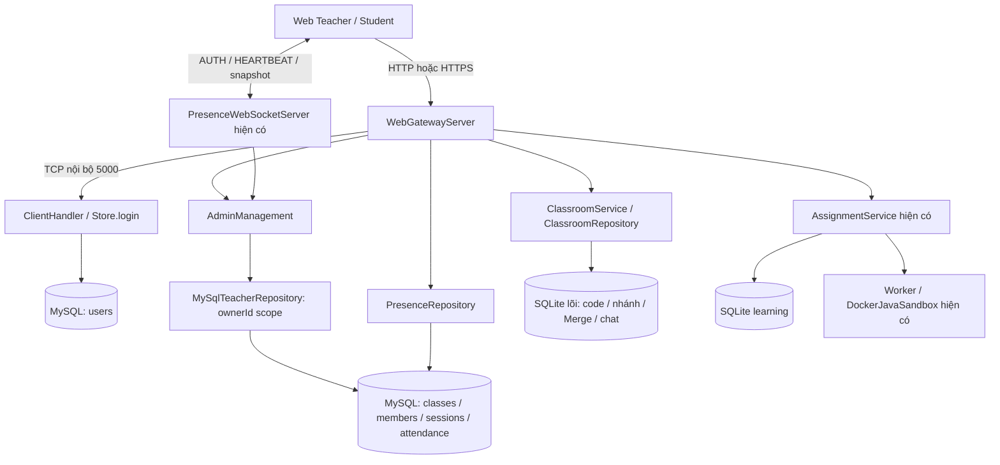

# Báo cáo nâng cấp StudyFix — Teacher Admin Management

Ngày kiểm tra: 04/11/2026. Báo cáo đối chiếu source thực tế, không coi tài liệu cũ là bằng chứng chức năng đã chạy.

**Thay đổi tiếp theo trong cùng ngày:** luồng Student đã được nâng cấp từ chỉ thấy lớp được cấp trước sang khám phá các lớp mở và xin giảng viên duyệt. Xem [luồng xin vào lớp và kết quả kiểm thử mới nhất](CLASS_ADMISSION_VI.md); các mô tả quyền khám phá lớp bên dưới phản ánh bản trước thay đổi này. Quyền truy cập nội dung lớp vẫn yêu cầu thành viên đã được duyệt.

## 1. Bảo vệ source và baseline

`git status` tại thư mục workspace và tại `StudyFix` đều báo chưa phải Git repository. Không reset/checkout/xóa source. Đã lưu bản sao 134 file source/test/cấu hình trước đợt hoàn thiện phân quyền tại `server/build/teacher-admin-source-baseline-20261104-192402.zip`.

Baseline có Java Backend, TCP điều khiển, HTTP gateway, WebSocket presence, SQLite lõi/learning, MySQL Management và frontend ES Modules. Build Ant trước đợt hoàn thiện đã thành công. Điểm chưa đạt yêu cầu mới là dashboard/quyền tài khoản còn rộng toàn hệ thống, chưa tách đủ các trang Teacher, và điểm danh có thể ghi đè lần vào trước.

Không mở hoặc sửa database vận hành để chạy test. MySQL80 hiện có được giữ nguyên. Kiểm thử MySQL dùng instance/datadir/cổng riêng, credential sinh ngẫu nhiên; không dùng password root của người dùng.

## 2. Kiến trúc trước và sau

Giữ cùng ứng dụng Java, cùng các module và giao thức. Không thêm Spring/React/Node backend, hệ thống đăng nhập hoặc WebSocket thứ hai.

Trong chế độ MySQL, MySQL là nguồn xác thực và quản lý tài khoản. SQLite giữ bản sao định danh để khóa ngoại, lịch sử và module code cũ tiếp tục hoạt động; bản sao đó không được tự dùng làm nguồn đăng nhập dự phòng. `runtime_binding`/`management_metadata` ràng buộc MySQL với đúng database lõi để tránh ghép nhầm roomId giữa hai bộ source/dữ liệu khác nhau.

## 3. Chức năng được tái sử dụng

- `Identity`: vẫn chỉ `TEACHER`, `STUDENT`; quyền Admin là quyền theo phạm vi, không thêm enum ADMIN.
- Đăng nhập web → TCP nội bộ → `Store.login()`, mật khẩu PBKDF2 và token/Session ID hiện có.
- `PresenceRepository`, `PresenceWebSocketServer`, heartbeat và polling dự phòng; không có bộ theo dõi kết nối song song.
- `Server`/`Room` cho tạo/vào/rời/xóa phòng; cơ chế khóa client → room và hàng đợi gửi hiện có.
- `ClassroomService`/`ClassroomRepository` cho WAITING → LECTURE → BRANCHING → MERGING, nhánh cá nhân, version guard, kiểm tra và Merge.
- Module ngân hàng/giao bài/nộp bài/progress, kỳ thi, worker và Docker sandbox; dashboard chỉ điều hướng tới module đó.
- Chat, gọi media, chia sẻ màn hình và signaling WebRTC hiện có.
- Giao diện Student, danh sách phòng, editor, draft và kết quả cá nhân hiện có.

## 4. Các chức năng đã hoàn thiện

### Teacher Admin Dashboard

Sidebar riêng và trang mặc định Teacher gồm Tổng quan, Lớp học của tôi, Sinh viên, Kết nối LAN, Điểm danh, Bài tập & tiến độ. Vẫn có đường tới phòng học trực tuyến, luyện code và kỳ thi.

Tổng quan lấy dữ liệu thật: lớp đang quản lý, sinh viên đã thuộc lớp, Online/Offline hệ thống, sinh viên trong lớp, phòng có người và sự kiện giảng dạy gần đây. Tài khoản mới tạo nhưng chưa thêm lớp không được tính thành sinh viên đã thuộc lớp.

Teacher tạo lớp, sửa tên, đóng/mở, quản lý thành viên bằng MSSV và xóa theo điều kiện của chủ phòng hiện có. Đóng lớp giữ dữ liệu và tách người tham gia; mở lại cho phép sinh viên đã được cấp quyền vào lại.

Teacher chỉ tạo tài khoản Student. Khóa/mở/đổi mật khẩu được xác nhận trên UI và kiểm tra quyền tại backend. Tài khoản do Teacher khác tạo hoặc đang dùng chung ở các lớp của nhiều Teacher không bị một Teacher tự thay đổi toàn cục. Sinh viên nhập từ dữ liệu cũ chỉ được quản lý tài khoản khi phạm vi lớp phù hợp; không tự đoán người tạo tài khoản.

### Kết nối và điểm danh

Mỗi login có token web, Session ID lõi và mã theo dõi kết nối riêng. API Teacher chỉ có mã theo dõi không dùng xác thực, không có token hay Session ID của sinh viên. Nhiều thiết bị cùng userId hoặc IP vẫn được quản lý độc lập.

Bảng LAN chỉ có các phiên từng tham gia lớp của Teacher. IP và hoạt động theo lớp được chụp vào bản ghi attendance, nên một phiên rời lớp A rồi đổi IP/tham gia ngữ cảnh khác không làm lộ IP mới cho giảng viên A qua lịch sử cũ. Dữ liệu cũ không có IP theo lớp được ghi rõ chưa có, không tự gán IP hiện tại thành IP lịch sử.

Điểm danh giữ từng lượt vào–ra trong `attendance.visits_json`; rời và vào lại bằng cùng phiên không mất lượt trước. Thời lượng được tính theo mốc thời gian server/heartbeat đã xác nhận. “Online hệ thống” và “đang trong lớp” là hai trạng thái riêng.

“Ngắt khỏi lớp” tách đúng kết nối trong đúng lớp; không đăng xuất mọi thiết bị và không tách người đó khỏi lớp B. Kiểm tra phòng đích được thực hiện dưới khóa client để tránh thao tác trễ áp dụng nhầm phòng sau khi người dùng chuyển lớp.

### Student Dashboard

Student vào Không gian học tập, có các mục lớp được phép tham gia, luyện code, thi/kết quả cá nhân. Không thấy điều hướng Admin. Ở chế độ MySQL, cả danh sách HTTP lẫn lệnh JOIN ở TCP lõi đều kiểm tra đã được thêm vào lớp, lớp đang mở và đúng quyền; không chỉ ẩn nút ở frontend.

Rời cuộc họp chỉ dừng media và về trang chính đúng vai trò, vẫn giữ tư cách thành viên. Rời phòng học là thao tác riêng. Refresh không khôi phục giao diện họp khi không còn tư cách thành viên.

## 5. API và phân quyền

| API / hành động | Quy tắc thực thi |
|---|---|
| `GET /api/admin` | Teacher; chỉ dữ liệu lớp sở hữu và sinh viên trong phạm vi hợp lệ. |
| `GET /api/admin?classId=...` | classId phải thuộc Teacher, kể cả lớp đã lưu trữ. ID lớp khác trả 403. |
| `POST /api/admin: CREATE_USER` | Chỉ Student; role Teacher từ body bị từ chối. Lưu `created_by` theo actor đã xác thực. |
| `SET_ACTIVE`, `RESET_PASSWORD` | Chỉ tài khoản Student có quyền quản lý phù hợp, không tài khoản Teacher/ngoài phạm vi/dùng chung. |
| `CREATE_CLASS` | Owner lấy từ phiên Teacher, không nhận owner tùy ý từ client. |
| `UPDATE_CLASS`, `DELETE_CLASS` | Kiểm tra owner tại backend; không xóa cứng lịch sử. |
| `ENROLL`, `ENROLL_CODE`, `REMOVE_MEMBER` | Chỉ thay đổi danh sách của lớp sở hữu; không tự sửa lớp khác. |
| `DISCONNECT_SESSION` | classId thuộc Teacher; tracking ID phải là phiên Student trong lớp đó. Chỉ tách khỏi lớp đích. |
| `GET /api/rooms` | MySQL: Teacher thấy lớp mình đang mở; Student thấy lớp mở đã được thêm. |
| `GET /api/rooms/current/presence` | Chỉ chủ lớp đang tham gia; Student/Teacher không sở hữu bị từ chối. |
| `GET /api/rooms/current` | Chỉ chủ lớp được bổ sung trường dữ liệu LAN quản trị. Thành viên khác không nhận trường đó. |
| WS `SUBSCRIBE admin` | Snapshot gọi cùng logic truy vấn theo owner như HTTP. Student không nhận dữ liệu Admin dù gửi frame SUBSCRIBE thủ công. |

Quyền được kiểm tra bằng Identity tại server, không lấy role/ownerId/userId actor do frontend tự khai báo. JDBC dùng prepared statement cho tham số. Dữ liệu UI được escape. Không trả password hash bằng dashboard hoặc WS.

IP lấy từ peer kết nối tại server; proxy header bị bỏ qua khi chưa có cấu hình tin cậy. Giới hạn đăng nhập được áp dụng theo tài khoản + IP và có trần IP tổng, để nhiều tài khoản hợp lệ dùng chung một IP vẫn hoạt động.

## 6. Database và an toàn migration

Không thay thế toàn bộ SQLite. Giữ các bảng MySQL `users`, `classes`, `class_members`, `sessions`, `attendance`; bổ sung cột vào bảng hiện có thay vì tạo bản sao song song:

- `users.created_by`: người tạo tài khoản Student; dữ liệu cũ NULL, không gán Teacher giả.
- `classes.closed`: đóng/mở lớp độc lập với xóa/lưu trữ.
- `attendance.visits_json`: lịch sử từng lượt tham gia.
- `attendance.ip_snapshot`, `activity_snapshot`: dữ liệu quan sát thuộc lớp đó, ngăn dữ liệu phiên ở ngữ cảnh sau chảy ngược vào lịch sử lớp trước.
- `schema_migrations` theo dõi nâng cấp; `runtime_binding` gắn đúng core SQLite.

Migration kiểm tra metadata trước ALTER, giữ nguyên userId/hash/hàng dữ liệu cũ, backfill lượt điểm danh cũ. Với lịch sử đã rời lớp mà thiếu IP snapshot, không thể khôi phục IP lịch sử chắc chắn nên để trống trường mới; IP raw trong sessions vẫn được giữ ở DB.

MySQL và SQLite có giao dịch riêng, không có distributed transaction. Ví dụ nếu metadata MySQL lỗi sau khi SQLite đã lưu một phòng mới, dữ liệu phòng không bị xóa; đồng bộ metadata được thử lại khi kết nối phục hồi/trang quản trị nạp lại/khởi động lại. Cần giữ đúng cặp database và dùng backup trước khi cấu hình.

Import tài khoản SQLite là bước bật rõ ràng bằng biến môi trường, giữ ID và hash, từ chối xung đột ID/username. Sau khi nhập, MySQL là nguồn xác thực duy nhất. Không tự chuyển sang một database mới khi cấu hình lỗi.

Import còn đưa lịch sử `network_sessions`/`classroom_connections` cũ sang các bảng MySQL hiện có một cách lặp lại được, giữ ID và thời gian, đánh dấu Offline. Không tự biến lịch sử cũ thành quyền tham gia lớp hiện tại; Teacher xác nhận danh sách bằng MSSV. Nếu dữ liệu điểm danh cũ chỉ giữ lượt gần nhất, không thể tạo lại những lượt trước đã bị ghi đè ở phiên bản cũ.

## 7. File chính được thêm/sửa

| Nhóm | File |
|---|---|
| Chính sách và truy vấn Teacher | `server/src/studyfix/MySqlTeacherRepository.java`, `AdminManagement.java`, `MySqlManagement.java` |
| Auth / toàn vẹn dữ liệu | `ManagementConfig.java`, `Store.java`, `PresenceRepository.java`, `db/mysql-schema.sql` |
| TCP, HTTP, WS / phòng | `Server.java`, `ClientHandler.java`, `WebGatewayServer.java`; tái sử dụng `PresenceWebSocketServer.java` |
| Cấp Teacher tại máy chủ | `ManagementCli.java`, `server/run-management-cli.ps1` |
| Teacher UI | `web-client/static/features/admin/admin.js`, `admin-view.js`, `static/admin.css` |
| Điều hướng theo vai trò | `static/core/roles.js`, `app.js`, `ui/render.js`, `core/state.js`, `features/auth/auth.js` |
| Live update / rời họp | `core/presence-socket.js`, `core/polling.js`, `features/room/room.js` |
| Cấu hình / build | `.env.example`, `.gitignore`, `load-env.ps1`, launchers, `resolve-tools.ps1`, `nbproject/project.properties`, `build.xml`, dependency verifier và JAR dưới `lib` |
| Test backend | `MySqlAdminIntegrationTest.java`, `TeacherScopeChecks.java`, `MySqlMigrationChecks.java`, `WebSocketPresenceIntegrationTest.java`, `LanPresenceIntegrationTest.java` và script test tạm |
| Test frontend/browser | `check_admin.mjs`, `check_teacher_roles.mjs`, `check_presence_socket.mjs`, các kiểm thử điều hướng cập nhật, `teacher_dashboard_browser.cjs` |
| Tài liệu | README, `LAN_IDENTITY_PRESENCE_VI.md`, `MYSQL_ADMIN_WEBSOCKET_VI.md`, báo cáo này |

Phần giao bài/chấm bài, chat, media, Master/nhánh/Merge không được viết lại. Thay đổi core liên quan đến xác thực, danh sách/điều kiện tham gia lớp và tách kết nối đúng phạm vi.

## 8. Kiểm chứng thực tế và giới hạn

Đã có baseline/hồi quy Ant thành công, kiểm thử MySQL thật trên instance riêng, RFC6455 thật và Chrome thật cho Teacher/Student, desktop/mobile. Các lần chạy thất bại trong quá trình phát triển được sửa rồi chạy lại; không coi lỗi readiness MySQL tạm hoặc mã lỗi API chưa tương thích là kết quả PASS.

Chi tiết lần chạy cuối và đường dẫn log được cập nhật ở cuối báo cáo. Những việc chưa được chứng minh bằng kiểm thử tự động trên máy này:

- Chưa chạy giữa hai máy LAN vật lý; test tự động dùng localhost. Quy trình LAN có trong hướng dẫn cấu hình.
- Chưa kiểm chứng media camera/mic/chia sẻ màn hình thực tế qua LAN ở lần nâng cấp này; test signaling/mô phỏng không thay thế kiểm thử media.
- Docker Engine chưa kết nối được trong môi trường cuối lần kiểm tra, nên không báo đã chạy AC/WA/CE bằng Docker thật lần này. Luồng API/queue/worker/persistence cũ được hồi quy, cần bật Docker để demo chấm thật.
- HTTPS/WSS dùng cấu hình TLS hiện có; browser E2E đã chạy HTTP/WS, chưa phải xác nhận chứng chỉ/WSS trên hai máy.
- Chưa benchmark tải lớn hoặc dữ liệu điểm danh nhiều năm. UI phân trang 10 dòng; dữ liệu nguồn hiện lấy trong phạm vi Teacher và lịch sử của lớp, chưa có phân trang server cho mọi báo cáo.
- File kiểm tra tĩnh `check_seven_bugfixes.mjs` cũ còn tham chiếu Swing client đã được xóa trước đợt này; không dùng nó để tuyên bố web đã đạt E2E. Các kiểm thử hành vi web liên quan được chạy riêng.
- Phân quyền mới bảo vệ dữ liệu quản trị; WebRTC P2P vẫn dùng ICE theo giao thức hiện có. Không tuyên bố đã ẩn hoàn toàn địa chỉ mạng của peer trong giao thức media.
- IP quản trị theo dõi web client hiện tại. Console TCP cũ không có phiên HTTP tương ứng trong bảng LAN web; không đổi giao thức cũ chỉ để thêm metadata.

Các schema/datadir kiểm thử nằm dưới `server/build`, không phải dữ liệu demo vận hành và không được dùng để thay thế DB thật. Không xóa database của người dùng để chạy lại test.

## 9. Cấu hình và chạy

Xem [hướng dẫn từng bước MySQL/LAN](MYSQL_ADMIN_WEBSOCKET_VI.md): kiểm tra MySQL80, tạo `studyfix_management`, cấp `studyfix_app`, đặt biến môi trường, import SQLite hoặc bootstrap Teacher, chạy launcher và mở cổng 8080/8081.

Chưa tự bật chế độ MySQL trên database đang vận hành của người dùng, vì chưa có credential ứng dụng và database riêng do người dùng cấp. Không dùng kết quả kết nối MySQL tạm để giả định môi trường vận hành đã được cấu hình.

Không có tài khoản demo mới với mật khẩu mặc định được đưa vào ứng dụng. Dùng Teacher hiện có sau import, hoặc Teacher bootstrap do người vận hành tự cấp mật khẩu. Tạo Student trên dashboard; cấp Teacher B qua CLI cục bộ hoặc import tài khoản Teacher cũ hợp lệ.

## 10. Kịch bản demo cho giảng viên hướng dẫn

1. Mở server đã cấu hình MySQL, kiểm tra health, đăng nhập Teacher A → dashboard riêng.
2. Tạo lớp Java 01, tạo Student với MSSV thật, thêm MSSV vào lớp.
3. Đăng nhập Teacher B trong trình duyệt khác → không có lớp/sinh viên riêng của A; thử classId A qua API phải 403.
4. Máy sinh viên trên LAN mở IP server, đăng nhập Student → không có Admin, chỉ có lớp được thêm và đang mở.
5. Student vào lớp, Teacher xem Kết nối LAN: đúng user, IP peer, thời gian và mã kết nối công khai.
6. Mở thêm thiết bị/trình duyệt cùng Student → nhiều phiên độc lập. Đăng xuất một phiên, phiên kia còn Online.
7. Ngắt một kết nối khỏi lớp → tài khoản hệ thống còn đăng nhập; thiết bị khác không bị tách.
8. Student rời/vào lại → nhiều lượt điểm danh. Teacher phân biệt Online hệ thống và hiện diện trong lớp.
9. Giảng bài, chọn bài, tách nhánh, sửa code, kiểm tra, Merge và chat bằng luồng cũ. Muốn chấm thật phải có Docker Engine/image Java sẵn sàng.
10. Mở Bài tập & tiến độ → vào đúng lớp để giao bài/xem bài nộp và báo cáo cũ; lớp đóng cần được mở lại trước khi vào module đó.
11. Tắt mạng Student, chờ timeout → Offline. Kết nối lại sau hết hạn → login mới, lịch sử cũ còn.
12. Đóng/mở lớp, restart server → tài khoản/lớp/code/điểm danh còn; phiên cũ không tự thành Online. Sau restart cần đăng nhập lại.

## 11. Kết quả kiểm thử cuối ngày 04/11/2026

| Hạng mục | Kết quả thực tế | Bằng chứng |
|---|---|---|
| Java/Ant `integration-test` | `BUILD SUCCESSFUL`, 2 phút 29 giây; chạy thư mục build/dist riêng | `server/build/teacher-admin-ant-regression.log` |
| MySQL thật, schema riêng và hai Teacher | **71 checks PASS**: quyền sở hữu lớp, Student bị từ chối, nhiều phiên, điểm danh, migration/import lịch sử cũ, restart và không fallback sai database | `server/build/mysql-isolated-run.log` |
| Chrome với HTTP/WS và MySQL thật | Đạt: đăng nhập Teacher/Student, điều hướng theo vai trò, WebSocket, bảng LAN, điểm danh, giao diện di động và chặn Student gọi API Admin | Cùng log MySQL; ảnh trong `server/build/teacher-admin-browser-qa/` |
| Frontend | **14 script đạt**, gồm kiểm tra imports/chu kỳ phụ thuộc, Admin, role, presence, lớp học, meeting, điều hướng, chat, contest, practice, phòng, screen audio, student connections và refresh dashboard | `server/build/teacher-admin-frontend-regression.log` |
| Đóng gói | JAR chứa schema MySQL, `MySqlTeacherRepository` và `ManagementCli` | `server/build/teacher-admin-package/studyfix.jar` |
| Dịch vụ đang có | `MySQL80` vẫn Running sau test; instance test đã dừng, không dùng database thật của người dùng | Kiểm tra Windows service sau test |

Kiểm thử frontend có transport/DOM/WebRTC mô phỏng được phân biệt rõ với Chrome E2E trong log; không dùng chúng để khẳng định mic/camera hoặc phát âm thanh đã chạy trên hai máy LAN. Kiểm thử Java/Ant dùng fixture riêng, không tạo tài khoản mặc định trong DB vận hành.

Rà soát cuối cũng sửa hai lỗi frontend: khi đổi tài khoản, xóa cache bản nháp/idempotency trong bộ nhớ để người tiếp theo không nhận code của người trước; nút đồng bộ dashboard gọi lại callback xác thực sẵn có thay vì gọi hàm không được import. Test practice hiện có 24 kiểm tra và có test riêng cho refresh dashboard. Dữ liệu nháp đã lưu theo từng user trong localStorage không bị xóa.

## 12. Việc người vận hành cần thực hiện

Code và kiểm thử môi trường tách biệt đã hoàn tất. **Database ứng dụng thực tế chưa được cấu hình**: chưa tạo `.env` chứa credential hay tự lấy mật khẩu MySQL của người dùng. Làm theo `MYSQL_ADMIN_WEBSOCKET_VI.md` để tạo database/tài khoản ứng dụng, điền `.env` cục bộ, sao lưu SQLite và chạy import lần đầu.

Sau đó chạy launcher hiện có, đăng nhập Teacher cũ đã import hoặc Teacher bootstrap với mật khẩu tự đặt; tạo Student và thêm vào lớp trên dashboard. Muốn kiểm thử Teacher B, dùng CLI quản trị cục bộ được hướng dẫn, không nâng quyền Student qua API Teacher.

Cần kiểm thử tiếp bằng **hai máy LAN thật**, chứng chỉ HTTPS/WSS và media, đồng thời bật Docker Engine trước khi kiểm chứng chấm AC/WA/CE thực tế. Không có mật khẩu kiểm thử hay bearer/session token được đưa vào báo cáo này.
